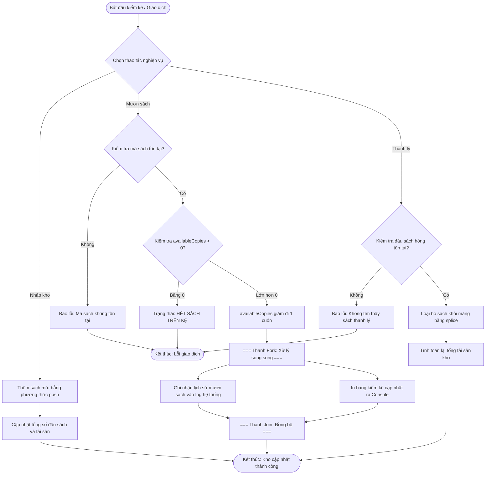

# BÁO CÁO BÀI TẬP: QUẢN TRỊ KHO ẤN BẢN THƯ VIỆN & KIỂM KÊ LƯU TRỮ TỰ ĐỘNG

> 👤 **Học viên:** Hoàng Công Dũng | **Mã SV:** PTIT-HCM-009
> 🏫 **Môn học:** it103b-rl-HoangCongDung

---

## 📊 Sơ đồ thiết kế hệ thống (Activity Diagram)

> 💡 *Sơ đồ dưới đây được render tự động trực tiếp trên GitHub bằng Mermaid. Bạn cũng có thể tải file **`bt1.drawio`** trong repository này để mở và chỉnh sửa trực tiếp trên [Draw.io (diagrams.net)](https://app.diagrams.net).* 

---

## 1. Mục tiêu và Bối cảnh bài toán

Bài tập này thực hành thao tác kiểm kê kho ấn bản trên cấu trúc dữ liệu Array of Objects trong Javascript. Nhiệm vụ cốt lõi là quản lý danh mục sách, cập nhật số lượng sách khả dụng khi có giao dịch mượn trả, xử lý thanh lý sách cũ hỏng và định giá tổng tài sản kho tri thức của thư viện.

- Sử dụng phương thức push để nhập mới ấn bản vào mảng kho.
- Kiểm soát chặt chẽ giá trị availableCopies để không bị âm khi mượn sách.
- Sử dụng phương thức splice để loại bỏ các ấn bản cũ hỏng khỏi danh mục.
- Tính toán tổng số lượng và tổng giá trị tài sản kho bằng vòng lặp for truyền thống.

## 2. Phân tích Quy tắc Nghiệp vụ và Bẫy Dữ liệu

Trong quá trình xây dựng hệ thống quản lý kho thư viện, việc kiểm tra tính hợp lệ của dữ liệu đầu vào là yếu tố quyết định sự ổn định của chương trình. Các bẫy dữ liệu thường gặp bao gồm việc giảm số lượng sách khả dụng quá giới hạn hoặc thao tác trên mã sách không tồn tại.

- Quy tắc 1: Khi mượn sách, hệ thống phải kiểm tra xem mã sách có tồn tại và availableCopies có lớn hơn 0 hay không.
- Quy tắc 2: Nếu availableCopies chạm mốc 0, hệ thống tự động gán nhãn 'HẾT SÁCH TRÊN KỆ' để thông báo cho thủ thư.
- Bẫy dữ liệu: Tuyệt đối không cho phép availableCopies giảm xuống dưới 0 dù phát sinh bất kỳ yêu cầu mượn bất thường nào.

## 3. Bảng đặc tả chi tiết quy trình kiểm kê kho

Bảng dưới đây mô tả chi tiết các bước xử lý nghiệp vụ trong ứng dụng quản lý kho thư viện:

| Bước | Tác nhân | Hành động nghiệp vụ | Điều kiện và Kết quả xử lý |
| --- | --- | --- | --- |
| 1 | Thủ thư | Nhập kho ấn bản mới | Thêm đối tượng sách vào mảng kho bằng push() |
| 2 | Sinh viên / Hệ thống | Yêu cầu mượn sách B01 | Kiểm tra mã sách và số lượng availableCopies > 0 |
| 3 | Hệ thống | Cập nhật số lượng khả dụng | Giảm availableCopies đi 1 đơn vị, kiểm tra nếu bằng 0 thì báo hết sách |
| 4 | Thủ thư | Thanh lý sách rách nát | Tìm kiếm vị trí phần tử và dùng splice() để xóa khỏi mảng |
| 5 | Hệ thống | Kiểm kê tổng tài sản kho | Dùng vòng lặp for nhân totalCopies với price để ra tổng giá trị |

## 4. Hướng dẫn sử dụng Mã nguồn và Kiểm thử

Mã nguồn được viết hoàn toàn bằng Javascript thuần, tuân thủ đúng tên file yêu cầu là 'practice_library_inventory.js'. Để chạy chương trình, sinh viên có thể sử dụng môi trường Node.js trực tiếp trên terminal.

Kết quả kiểm kê tài sản kho sẽ được in ra console dưới dạng bảng hiển thị trực quan, giúp giảng viên dễ dàng chấm điểm và kiểm tra logic.

---

## 📁 Danh sách tệp tin nộp bài trong Repository
- 📝 `bt1.docx`: Báo cáo tài liệu phân tích nghiệp vụ hoàn chỉnh.
- 🎨 `bt1.drawio`: File thiết kế sơ đồ chuẩn theo quy định đề bài (mở trực tiếp bằng [Draw.io](https://app.diagrams.net) hoặc Lucidchart).
- 💻 `practice_library_inventory.js`: Mã nguồn chương trình.
